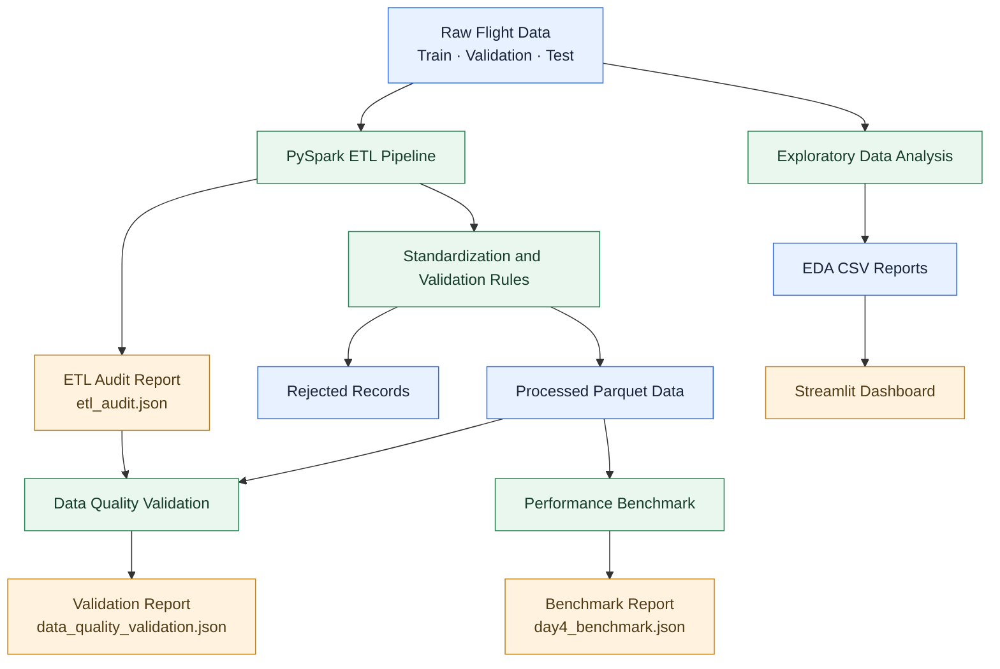

# FlightGraph — Large-Scale Flight Data Engineering & Delay Analytics

FlightGraph is a Big Data Engineering project that uses PySpark to
process large-scale flight records, validate data quality, benchmark
Parquet data scans, and visualize flight-delay patterns through an
interactive Streamlit dashboard.

## Project Highlights

- Processed 44,858,151 records across training, validation, and test splits.
- Built a PySpark ETL pipeline for data standardization and validation.
- Stored processed datasets in Parquet format.
- Generated audit reports for accepted and rejected record counts.
- Implemented data-quality checks for dates, required fields, and delay labels.
- Benchmarked Parquet file sizes and full-count scan timings.
- Created a Streamlit dashboard for overall, monthly, and airline-wise delay analysis.

## Technology Stack

- Python
- PySpark and Apache Spark
- Parquet
- Pandas
- Streamlit
- JSON audit reports
- Matplotlib

## Architecture

Raw Parquet Data
        |
        v
PySpark ETL Pipeline
        |
        v
Data Standardization and Validation
        |
        +-------------------+
        |                   |
        v                   v
Processed Parquet      Rejected Records
        |
        v
Data Quality Validation
        |
        v
Performance Benchmarking
        |
        v
EDA Reports and Streamlit Dashboard

## Architecture

## Dataset Overview

| Split | Records |
|---|---:|
| Train | 31,149,502 |
| Validation | 6,743,403 |
| Test | 6,965,246 |
| Total | 44,858,151 |

The dataset contains 65 columns in each split.

## Key Findings

- 5,560,469 training records had an arrival delay of 15 minutes or more.
- The observed 15+ minute arrival-delay rate was 17.85% in the training data.
- Airline-level and month-wise delay patterns were explored through visualizations.
- The ETL audit counts matched the accepted record counts.
- All three processed dataset splits passed the implemented data-quality validation checks.

## Project Structure

FlightGraph/
├── data/
│   ├── raw/
│   ├── processed/
│   └── rejected/
├── dashboard/
│   └── app.py
├── reports/
│   ├── eda_summary.csv
│   ├── monthly_delay.csv
│   ├── airline_delay.csv
│   ├── etl_audit.json
│   ├── data_quality_validation.json
│   └── day4_benchmark.json
└── src/
    ├── 01_inspect_data.py
    ├── 02_data_quality.py
    ├── 03_duplicate_check.py
    ├── 04_invalid_values.py
    ├── 05_eda.py
    ├── 08_etl_pipeline.py
    ├── 10_validate_processed.py
    ├── 11_pipeline_benchmark.py
    └── 13_final_project_check.py

## How to Run

Install the project dependencies in a Python environment with compatible
Spark and Java versions.

Run the ETL pipeline:

    python src/08_etl_pipeline.py

Run data-quality validation:

    python src/10_validate_processed.py

Run the performance benchmark:

    python src/11_pipeline_benchmark.py

Launch the Streamlit dashboard:

    python -m streamlit run dashboard/app.py

Use the configured Python environment and Hadoop Windows utilities
where required.

## Performance Benchmark

The processed Parquet datasets occupied approximately 2,015.81 MB
in total during the recorded benchmark.

The train, validation, and test full-count scans completed in
approximately 2.98 seconds, 0.186 seconds, and 0.183 seconds,
respectively, on the tested local Spark setup.

These timings are environment-dependent and represent count scans,
not the complete ETL execution time.

## Limitations

- Spark was tested in local mode with two worker threads, not on a multi-node cluster.
- Initial duplicate checks were sample-based.
- Initial invalid-value screening covered selected fields in a sample.
- No flight-delay prediction model has been implemented in this version.
- The analysis describes observed patterns and does not establish causal relationships.

## Future Improvements

- Add automated regression tests and pipeline monitoring.
- Evaluate partitioning and storage optimizations.
- Add cloud-based storage and workflow orchestration.
- Explore flight-delay prediction after feature validation.
